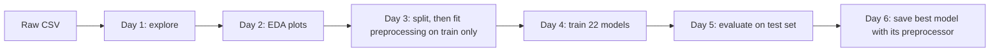

# Heart Disease Prediction on the UCI Dataset

A six-day machine learning project, completed as the ML module of the ASMICORE Semiconductor academic internship programme. It takes the UCI Heart Disease dataset from raw CSV to saved, reusable models, and compares 22 classifiers on two versions of the same problem.

| Document | What it contains |
|----------|------------------|
| [LEARNING_GUIDE.md](LEARNING_GUIDE.md) | Teaching walkthrough of the whole project, day by day, with the concepts behind each step and self-check questions |
| [ASMICORE_SUBMISSION_REPORT.md](ASMICORE_SUBMISSION_REPORT.md) | Formal submission report with full statistics |
| [logs/learning_notes.md](logs/learning_notes.md) | Session-by-session learning notes (Conda, Git, Pandas, metrics, models) |
| [logs/issue_log.md](logs/issue_log.md) | Problems met during the project and how each was solved |
| [logs/experiment_log.md](logs/experiment_log.md) | Day-by-day log from the first version of the project |

## The problem

The target column `num` describes heart disease for each patient. The project models it in two ways:

| Task | Classes | Meaning |
|------|---------|---------|
| Multiclass severity | 0, 1, 2, 3, 4 | 0 = no disease, 1 to 4 = increasing severity |
| Binary presence | 0, 1 | 0 = no disease, 1 = disease (`num` 1 to 4 merged) |

This is an educational project. The models are not intended for clinical use.

## Dataset

| Item | Value |
|------|-------|
| Source | UCI Heart Disease (four hospitals: Cleveland, Hungary, Switzerland, VA Long Beach) |
| File | `data/heart_disease_uci.csv` |
| Size | 920 rows, 16 columns |
| Features used | 14 (6 numeric, 8 categorical); `id` and `num` removed |
| Features after encoding | 29 |
| Missing values | 1,759 in total; largest in `ca` (611), `thal` (486) and `slope` (309) |
| Class balance (multiclass) | 0: 411, 1: 265, 2: 109, 3: 107, 4: 28 |
| Class balance (binary) | 0: 411, 1: 509 |

## Results

Both tasks use the same stratified 80/20 split (736 training rows, 184 test rows, `random_state=42`). Models are ranked by weighted F1 on the test set.

**Binary presence: top five of 22**

| Rank | Model | Accuracy | Weighted F1 | ROC-AUC |
|------|-------|----------|-------------|---------|
| 1 | Gaussian Naive Bayes | 0.870 | 0.869 | 0.917 |
| 2 | CatBoost | 0.864 | 0.864 | 0.918 |
| 3 | LightGBM | 0.864 | 0.863 | 0.914 |
| 4 | RBF SVM | 0.864 | 0.862 | 0.922 |
| 5 | Random Forest (RandomizedSearchCV) | 0.859 | 0.858 | 0.933 |

**Multiclass severity: top five of 22**

| Rank | Model | Accuracy | Weighted F1 | ROC-AUC |
|------|-------|----------|-------------|---------|
| 1 | HistGradientBoosting | 0.614 | 0.610 | 0.829 |
| 2 | Gradient Boosting | 0.614 | 0.593 | 0.832 |
| 3 | XGBoost | 0.592 | 0.580 | 0.845 |
| 4 | Bagging | 0.592 | 0.579 | 0.832 |
| 5 | Random Forest (RandomizedSearchCV) | 0.603 | 0.578 | 0.857 |

How to read these results:

- The binary task is well solved. About 87 % of test patients are classified correctly, against 55 % for a model that always guesses "disease".
- The multiclass task is much harder. Severity classes 2, 3 and 4 are small (class 4 has only 28 patients), and the features separate "disease" from "no disease" far better than they separate one severity level from another.
- The top binary models differ by one or two patients out of 184 (one patient is 0.0054 of accuracy). The ranking among the top five is therefore not reliable; cross-validation would give a fairer comparison. See [LEARNING_GUIDE.md](LEARNING_GUIDE.md), section 7.

The full tables for all 22 models are in `outputs/reports/model_comparison_table.csv` and `outputs/reports/model_comparison_table_binary.csv`.

## Models compared

| Family | Models |
|--------|--------|
| Baseline | Dummy classifier (most frequent class) |
| Linear | Logistic Regression, Ridge, SGD, Perceptron, Linear SVM, LDA, Nearest Centroid |
| Distance and kernel | K-Nearest Neighbours, RBF SVM |
| Probabilistic | Gaussian Naive Bayes |
| Single tree | Decision Tree |
| Bagging ensembles | Random Forest, Extra Trees, Bagging, tuned Random Forest |
| Boosting ensembles | AdaBoost, Gradient Boosting, HistGradientBoosting, XGBoost, LightGBM, CatBoost |

## Workflow



The same steps run twice in `scripts/main.py`: once for the multiclass target and once for the binary target.

## Project structure

```text
.
├── data/
│   ├── heart_disease_uci.csv          raw dataset
│   └── processed/                     train/test splits after preprocessing (multiclass and *_binary)
├── notebooks/                         the six-day workflow, one notebook per day
│   ├── day1_data_exploration_IMPROVED.ipynb
│   ├── day2_eda_IMPROVED.ipynb
│   ├── day3_feature_engineering.ipynb
│   ├── day4_model_training.ipynb
│   ├── day5_evaluation.ipynb
│   └── day6_final_pipeline_IMPROVED.ipynb
├── scripts/
│   ├── main.py                        runs the full pipeline for both targets
│   └── utils.py                       loading, preprocessing, model zoo, evaluation helpers
├── outputs/
│   ├── models/                        trained models, preprocessors and final bundles
│   ├── reports/                       JSON reports, comparison tables, model usage guides
│   └── visualizations/                EDA and evaluation plots
├── logs/                              learning notes, issue log, experiment log
├── LEARNING_GUIDE.md
├── ASMICORE_SUBMISSION_REPORT.md
├── environment.yml                    full Conda environment (ml_1)
└── requirements.txt                   pinned pip packages
```

## Running the project

Create the environment and run the full pipeline:

```bash
conda env create -f environment.yml
conda activate ml_1
python scripts/main.py
```

Or open the notebooks and run them in order, Day 1 to Day 6.

## Using a saved model

Each final bundle holds the trained model, the fitted preprocessor and the feature names, so prediction starts from raw patient rows.

```python
import joblib
import pandas as pd

bundle = joblib.load("outputs/models/gaussian_nb_final_bundle_binary.pkl")   # binary: 0 or 1
# bundle = joblib.load("outputs/models/hist_gradient_boosting_final_bundle.pkl")  # multiclass: 0 to 4

raw_rows = pd.DataFrame([...])  # same 14 feature columns as the CSV, without id and num
X_new = pd.DataFrame(bundle["preprocessor"].transform(raw_rows), columns=bundle["feature_names"])
prediction = bundle["model"].predict(X_new)
```

More detail: `outputs/reports/MODEL_USAGE_GUIDE.txt` and `MODEL_USAGE_GUIDE_binary.txt`.

## Method notes

- The data is split into train and test sets before any imputation, encoding or scaling, so no information from the test set leaks into training.
- Numeric features: median imputation, then standard scaling. Categorical features: most-frequent imputation, then one-hot encoding.
- Weighted F1 is the selection metric because the classes are imbalanced.
- ROC-AUC is missing for Ridge, Linear SVM and Perceptron in the multiclass task: they give decision scores, not the class probabilities that multiclass ROC-AUC needs.

## Known limitations and next steps

- 172 rows have a cholesterol value of 0, which is a missing value recorded as zero. The imputer only replaces empty cells, so these zeros are currently used as real values.
- The `dataset` column (hospital of origin) is used as a feature. Disease rates differ strongly between hospitals (93.5 % in Switzerland, 36.2 % in Hungary), so a model can partly learn the hospital instead of the patient.
- The best model is chosen on a single test split of 184 rows. Stratified k-fold cross-validation would give more stable rankings.
- Only Random Forest is tuned. Tuning the boosting models, and adjusting the decision threshold for higher recall, are natural next steps.
